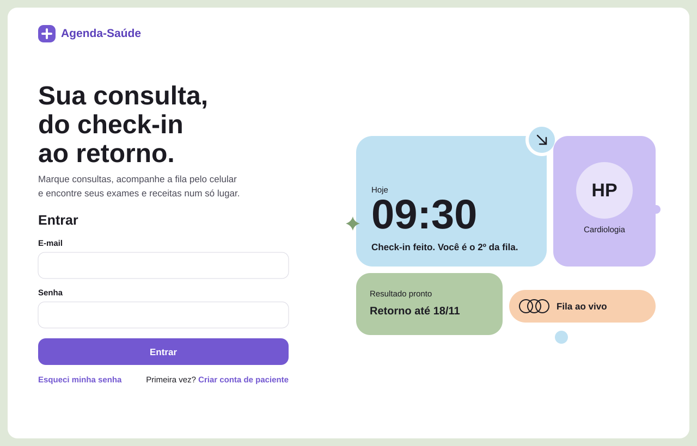
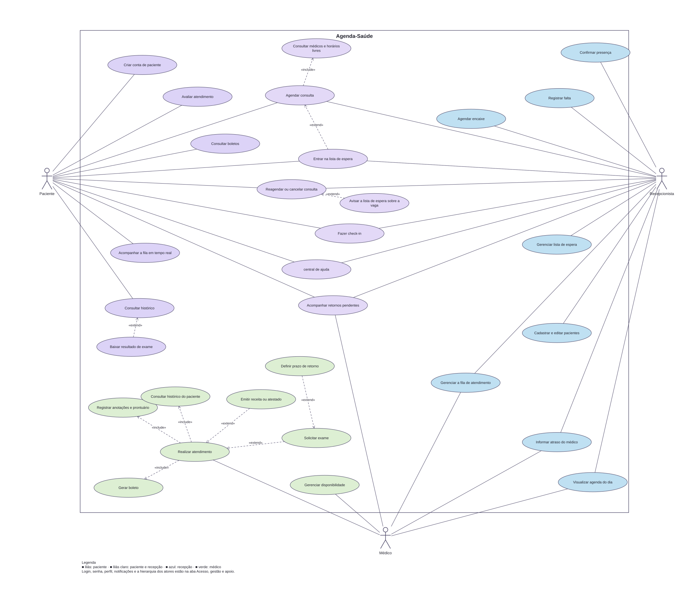
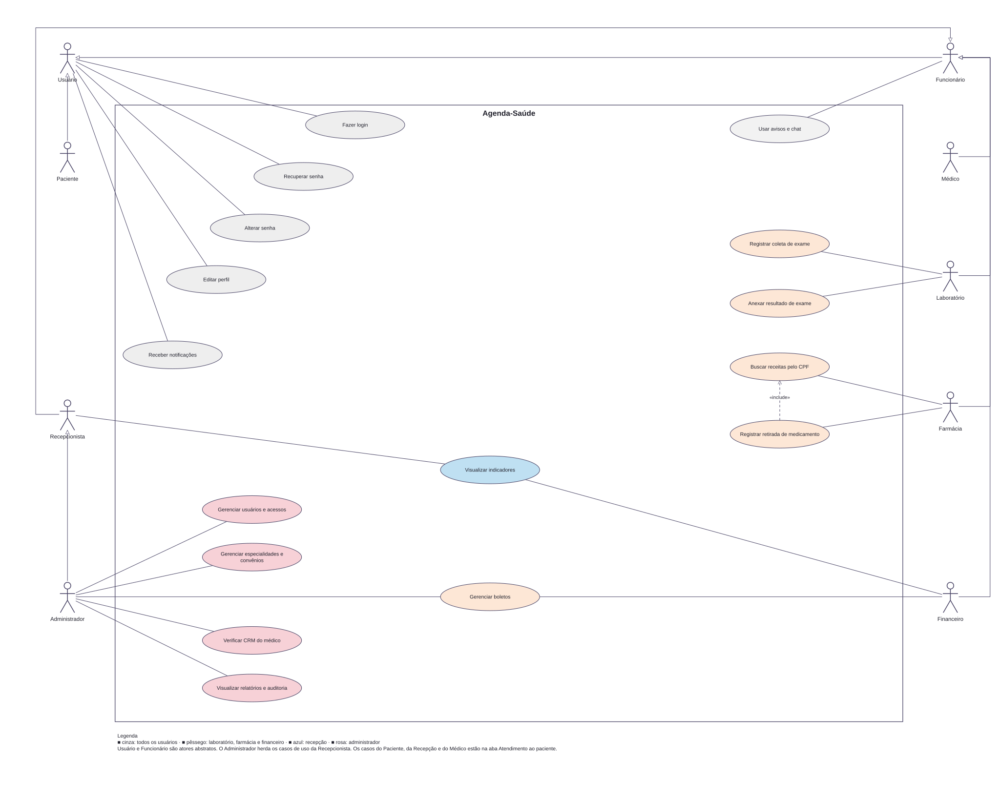
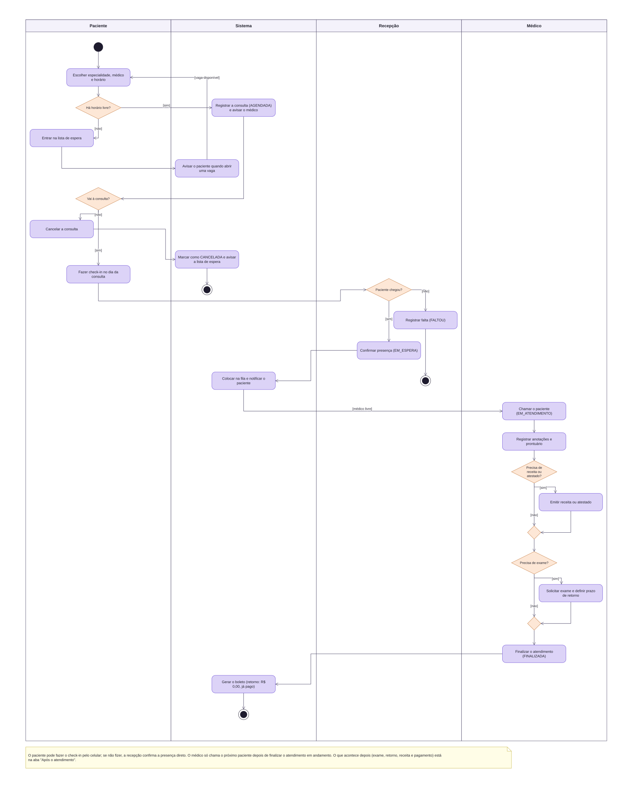
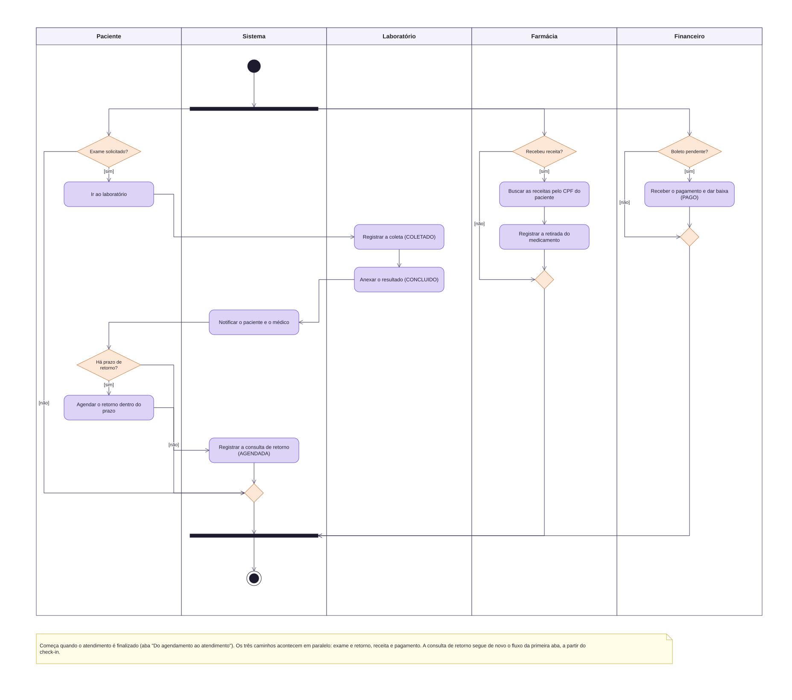
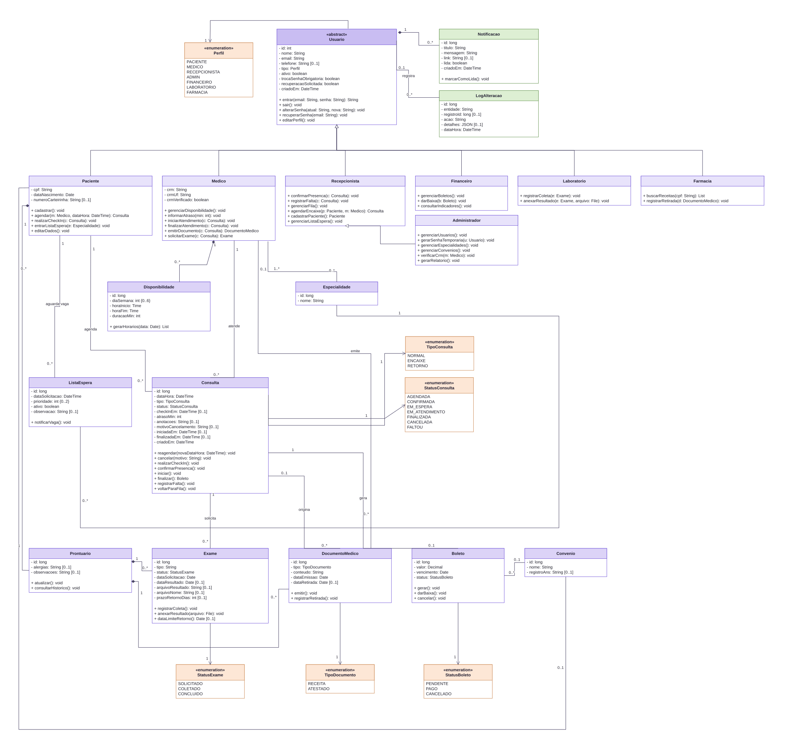
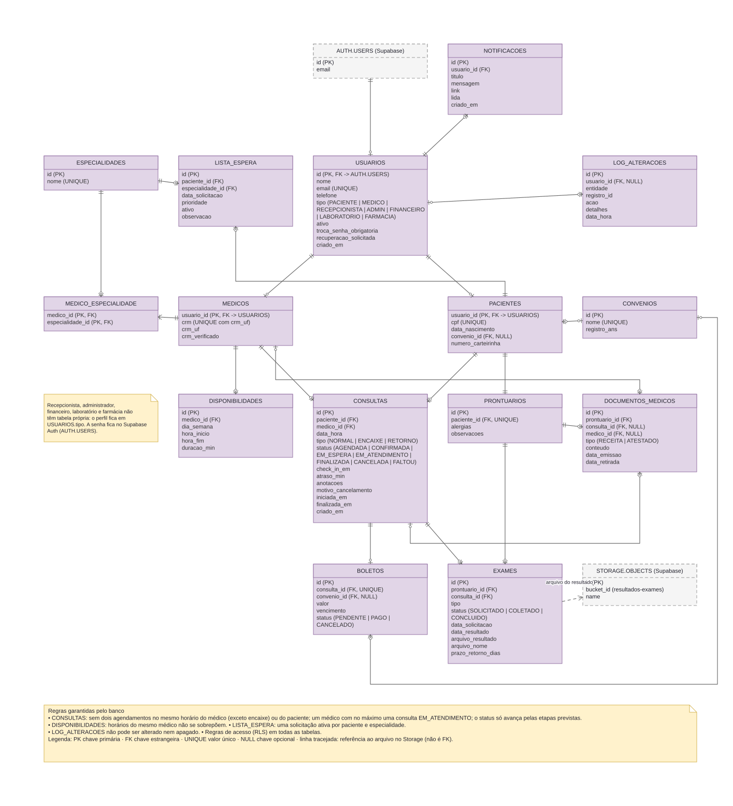

# Agenda-Saúde

Sistema de agendamento médico e gestão de atendimento clínico, desenvolvido para integrar pacientes, profissionais de saúde e equipes administrativas em uma única plataforma.

A solução acompanha a jornada do paciente desde o agendamento até o retorno, incluindo check-in, fila de atendimento em tempo real, controle de atrasos, encaixes, lista de espera e indicadores.

## Tela de login



*Representação visual em tema claro, recriada a partir do código da interface; não é uma captura da aplicação em execução.*

## Funcionalidades

| Perfil | Principais recursos |
| --- | --- |
| Paciente | Agendamento, check-in, fila, consultas, histórico, receitas, exames, lista de espera e boletos |
| Recepção | Agenda, confirmação de presença, encaixes, remarcações, atrasos, fila e pacientes |
| Médico | Atendimento, prontuário, receitas, atestados, exames, retornos e disponibilidade |
| Administrador | Usuários, permissões, especialidades, convênios, relatórios e auditoria |
| Financeiro | Boletos e indicadores |
| Laboratório | Exames |
| Farmácia | Retirada de receitas |

## Tecnologias

- **Frontend:** React, TypeScript, Vite e React Router.
- **Backend:** Node.js, Express e TypeScript.
- **Banco de dados:** PostgreSQL e Supabase;
- **Tempo real:** Server-Sent Events (SSE).
- **Modelagem:** UML e diagrams.net (Draw.io).

## Documentação visual

As imagens SVG são representações geradas a partir dos arquivos Draw.io versionados. O roteamento visual dos conectores pode diferir do editor original. Os arquivos editáveis continuam disponíveis nos links abaixo.

### Diagrama de casos de uso

**Atendimento ao paciente**



**Acesso, gestão e apoio**



### Diagrama de atividades

**Do agendamento ao atendimento**



**Após o atendimento**




### Diagrama de classes



### Diagrama do banco de dados




## Executar localmente

Pré-requisitos: Node.js 22.13 ou superior e npm.

```bash
git clone https://github.com/MariaLuizaNovasky/Agenda-Saude.git
cd Agenda-Saude
npm install
npm run dev
```

## Estrutura do projeto

```text
Agenda-Saude/
├── frontend/       Interface e páginas por perfil
├── backend/        API, regras de negócio e acesso a dados
├── docs/imagens/   Imagens da documentação
└── README.md
```
